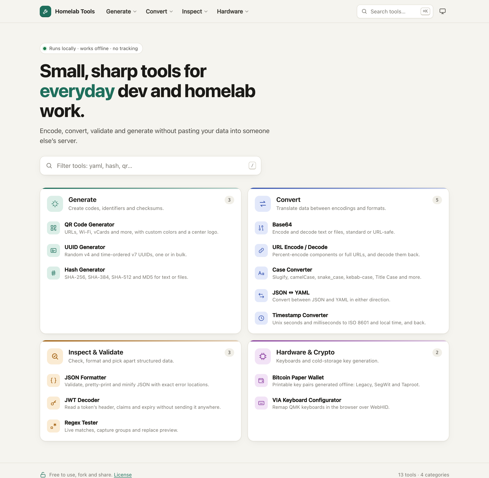
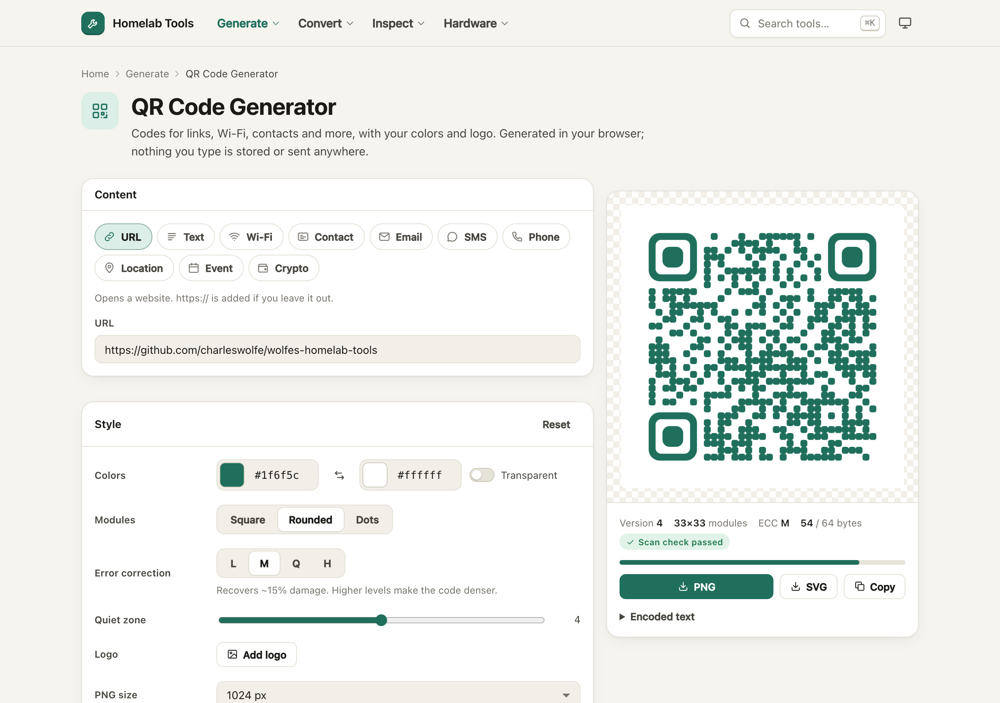
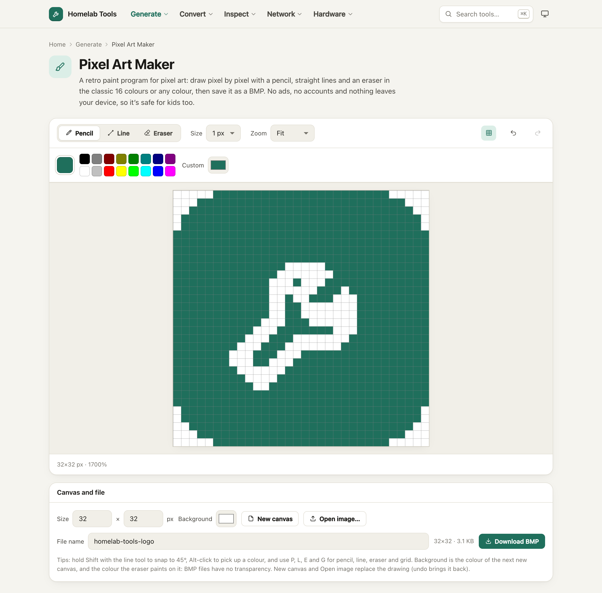
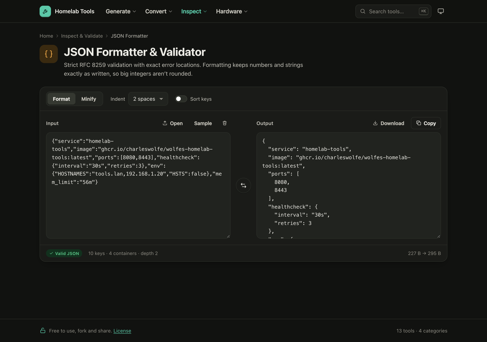

# wolfes-homelab-tools

**Docker image:** [`ghcr.io/charleswolfe/wolfes-homelab-tools`](https://github.com/charleswolfe/wolfes-homelab-tools/pkgs/container/wolfes-homelab-tools) for `amd64`, `arm64` and `arm/v7` (Raspberry Pi)

```sh
docker pull ghcr.io/charleswolfe/wolfes-homelab-tools:latest
```

Free, open-source browser utilities for homelab and self-hosting: a QR code generator, a pixel art maker, a password generator, an IP subnet calculator, a DNS lookup, an SPF & DMARC checker, a Bitcoin paper wallet, a JSON formatter and validator, the VIA keyboard configurator, and more. Everything is static HTML and JavaScript that runs in your browser.

- **Private and offline.** Pages never contact another host: no CDNs, web fonts, analytics or trackers. A same-origin Content-Security-Policy enforces this, and the test suite fails if anything slips in. The one exception is the DNS pages (DNS Lookup, and the SPF & DMARC Checker's domain lookups), which send DNS-over-HTTPS queries to the resolver you pick, only when you click the button; their scripts and styles still come only from your server.
- **Small.** One `scratch`-based image of about 13 MB, served by [static-web-server](https://static-web-server.net) as a non-root user, with every file pre-compressed and held in memory.

| Category | Tools |
|---|---|
| Generate | QR Code · Password & Passphrase · Pixel Art Maker · UUID · Hash (SHA-256/384/512, MD5) |
| Convert | Image Converter (PNG, JPEG, WebP, AVIF) · Base64 · URL Encode/Decode · Case & Slugify · JSON ↔ YAML · Timestamp |
| Inspect & Validate | JSON Formatter · JWT Decoder · Regex Tester |
| Network | IP Subnet Calculator (IPv4 and IPv6) · DNS Lookup (DNS-over-HTTPS, resolver comparison, DNSSEC) · SPF, DKIM & DMARC Checker |
| Hardware & Crypto | Bitcoin Paper Wallet · VIA Keyboard Configurator |

## Screenshots



*The home page: every tool grouped into five categories, with a filter box. ⌘K / Ctrl K opens search from any page.*



*QR Code Generator: a URL drawn with rounded modules in a custom colour. The scan check confirms the code still decodes before you download it as PNG or SVG.*



*Pixel Art Maker: the site's logo redrawn as 32×32 pixel art, zoomed with the pixel grid on. Pencil, line and eraser tools, the classic 16-colour palette, and a BMP download.*



*JSON Formatter, in dark mode: minified JSON pretty-printed and validated, with key, container and size counts below.*

## Quick start

```sh
docker run -d --name homelab-tools --restart unless-stopped \
  -p 8080:8080 --memory 56m \
  ghcr.io/charleswolfe/wolfes-homelab-tools:latest
```

Then open `http://<host>:8080`.

Everything works over plain HTTP except VIA, which needs [HTTPS](docs/https.md). The Bitcoin wallet works over HTTP, but HTTPS is recommended. Both pages show a banner explaining why.

To build the image yourself, or to install on a host without internet access, see [Install and run](docs/install.md).

## Documentation

| Guide | Covers |
|---|---|
| [Install and run](docs/install.md) | Published image and tags, building it yourself, offline hosts, updating |
| [HTTPS](docs/https.md) | Mounted certificates, Compose secrets, reverse proxies, getting a certificate offline |
| [Certificates with step-ca](docs/step-ca.md) | Running your own certificate authority that issues and renews the certificate |
| [Docker Compose](docs/docker-compose.md) | Copy-paste compose files for each setup |
| [Portainer](docs/portainer.md) | Deploying as a stack or a single container |
| [Configuration](docs/configuration.md) | Environment variables, security headers, memory and caching |
| [Troubleshooting](docs/troubleshooting.md) | Certificate, redirect and HTTPS errors |
| [Development](docs/development.md) | Tests, dev server, project layout, rebuilding VIA, publishing the image |

## License

[MIT with the Commons Clause](LICENSE): use it, change it, reskin it, fork it and share it, for any purpose, but don't sell it. That includes charging for hosting or support whose value comes from this project.

Bundled third-party code keeps its own license and isn't covered by the Commons Clause: VIA is GPL-3.0 (`site/via/app/LICENSE.txt`), and the libraries in `site/vendor/` are MIT (see `site/vendor/README.md`).
